# adamacs_ingest

ADAMACS (Architectures for Data Management and Computational Support) is the Rose Lab framework for managing and
analysing multimodal neuroscience data. It is a DataJoint pipeline: every recording, processing step and derived
result is a row in a typed table, linked to its inputs by foreign keys. A result can therefore always be traced back
to the raw data and parameters it came from.

`adamacs_ingest` is the **ingest-first** ADAMACS repository. It holds:
* the pipeline activation;
* the lab's own schemas;
* the ingest code and the ingest GUI;
* the newer lab schemas (cell registration, responsiveness).

Students use it directly for day-to-day ingest; no routine fork is needed.

> **Live ADAMACS documentation (Read the Docs):** <https://adamacs-documentation.readthedocs.io>
> **Documentation source:** <https://github.com/trose-neuro/adamacs_documentation>
> That site is the canonical guide for setup, the ingest GUI, analysis links, schema chapters, infrastructure and
> troubleshooting. This README documents the repository and the schemas, including the ones added since the
> documentation was last updated.

---

## Contents

1. [Scope and repository map](#scope-and-repository-map)
2. [Installation](#installation)
3. [DataJoint configuration](#datajoint-local-configuration)
4. [Running ingest](#run-ingest-workflows)
5. [Schemas](#schemas): overview, the core chain, then every schema with its diagram
   - [imaging and the stored dF/F0](#imaging): new since November 2026
   - [cell_registration](#cell_registration): cross-session cell identity
   - [responsiveness](#responsiveness-not-yet-deployed): not yet deployed
6. [Servers, environments and workers](#servers-environments-and-workers)
7. [Releasing changes to the SFB1089 element fork](#releasing-changes-to-the-sfb1089-element-fork)
8. [Rules for working on the production database](#rules-for-working-on-the-production-database)
9. [Local checks and CI](#local-checks-and-ci-parity)
10. [Further documentation](#further-documentation)

---

## Scope and repository map

| Path | Contents |
|---|---|
| `adamacs/pipeline.py` | Activates every schema of the pipeline under the configured prefix (`roselab_` in production). **Importing it declares tables the database lacks and inserts lookup contents.** Do not import it just to look at data (see [rules](#rules-for-working-on-the-production-database)). |
| `adamacs/schemas/` | Lab schemas: `subject`, `surgery`, `equipment`, `behavior`, `analysis`, `pupil_tracking`, `denoising`, `mocap`, `virtual_markers_optitrack`, `disk`, `wfield`, `cell_registration`, `ingest`, `responsiveness` (+ design reviews `CELL_REGISTRATION_SCHEMA_DESIGN_REVIEW.md`, `DESIGN_NOTE_samesite_key.md`) |
| `adamacs/ingest/` | Ingest and population logic per modality (sessions, Bpod, HARP, aux, DLC, CellReg export/import/register) |
| `adamacs/responsiveness/` | Pure computation behind the responsiveness schema (parsers, statistics, photon transfer, ZETA, tuning); `dff0.py` re-exports `element_calcium_imaging.dff` |
| `adamacs/workers/` | Long-running workers that live in this repo (`cellreg_worker.py`) |
| `adamacs/helpers/` | Helpers used by notebooks and ingest (`stack_helpers.calculate_dFF` is a deprecated wrapper around the element's dF/F0) |
| `adamacs/gui.py`, `adamacs/nbgui.py` | Ingest GUI (`select_sessions`) |
| `notebooks/` | Ingest notebooks, renumbered; `00_ingest_gui_workflow_adamacs_ingest_v2.ipynb` is the centre-stage workflow; 17–19 cover cell registration |
| `notebooks/schema_diagrams/` | The diagrams in this README (regenerate with `scripts/draw_schema_diagrams.py`) |
| `examples/batch_ingest/` | Batch ingest templates by modality |
| `scripts/` | Installer, diagram generators, CellReg and dF/F0 verification tools |
| `skills/` | Published copies of Claude skills (e.g. `skills/cellreg/SKILL.md`) |
| `docs/` | Workflow notes, notebook index, design proposals (`DFF0_IN_ACTIVITY_MAKE_PROPOSAL.md`, `RESPONSIVENESS_SCHEMA_PROPOSAL.md`) |
| `tests/` | Offline tests (run in CI without a database) |

---

## Installation

### One-stop install (recommended)

```bash
./scripts/install_datajoint_ingest.sh            # creates/updates the env "datajoint_ingest"
./scripts/install_datajoint_ingest.sh my_env     # custom env name
```

The installer:
* creates a Python 3.11 conda env;
* installs Graphviz and the pinned DataJoint pre-2.0 stack (`datajoint==0.14.8`);
* installs this package editable;
* handles `pywavesurfer` and `scanimage-tiff-reader`;
* runs `pip check`.

### Manual install (same stack)

```bash
conda create -n datajoint_ingest python=3.11 -y
conda install -n datajoint_ingest -y graphviz
conda run -n datajoint_ingest python -m pip install --upgrade pip wheel "setuptools<81"
conda run -n datajoint_ingest python -m pip install -r requirements_datajoint_new.txt
conda run -n datajoint_ingest python -m pip install -e .
conda run -n datajoint_ingest python -m pip install --no-deps "pywavesurfer @ git+https://github.com/SFB1089/PyWaveSurfer.git"
conda run -n datajoint_ingest python -m pip install scanimage-tiff-reader==1.4.1.4
```

If the `scanimage-tiff-reader` wheel fails: `conda install -n datajoint_ingest -y -c conda-forge scanimage-tiff-reader`.

**The DataJoint elements come from the SFB1089 forks.** `element-calcium-imaging` is installed from
`git+https://github.com/SFB1089/element-calcium-imaging.git`. The lab deploys **tagged releases** of that fork (currently
`roselab-0.1.0b1`); see [releasing](#releasing-changes-to-the-sfb1089-element-fork).

**Two repositories install a package called `adamacs`.** `adamacs_ingest` (this repo) and the older `SFB1089/adamacs`
(checked out at `~/adamacs`) both provide it, and which one an environment imports depends on its editable install.
See [environments](#servers-environments-and-workers). The cell-registration code exists only here. If an import
such as `cannot import name 'cellreg_plan' from 'adamacs.ingest'` names `~/adamacs`, the wrong checkout is on
`sys.path`.

---

## DataJoint local configuration

```bash
cp Example_dj_local_conf.json dj_local_conf.json      # then edit credentials and paths
git ls-files | grep -Ei '(^|/)dj_local_conf.*\.(json|joson)$|(^|/)dj_local_.*\.(json|joson)$'   # must print nothing
```

* `dj_local_conf.json` (and typo variants such as `.joson`) are git-ignored, and CI refuses to run if one is tracked.
* On the lab servers the config lives in `~/adamacs/dj_local_conf.json`. It sets `custom.database.prefix = "roselab_"`
  and the external stores (`external-raw` → `/datajoint-db/blobs/roselab`).
* DataJoint reads the config from the **working directory**, so run scripts from a directory that has one.

**TLS handshake failure** (`SSLV3_ALERT_HANDSHAKE_FAILURE` on `dj.conn()`): in DataJoint 0.14.x, `database.use_tls: null`
can trigger a TLS attempt. Set `"database.use_tls": false` for the non-TLS lab server.

---

## Run ingest workflows

### GUI entrypoint (primary workflow)

```python
from adamacs.gui import select_sessions
select_sessions(["TR_WEZ-8701_2025-01-20_sessABC_scanXYZ"])
```

The centre-stage notebook is `notebooks/00_ingest_gui_workflow_adamacs_ingest_v2.ipynb`. Set its parameters in the
notebook's parameter cell:

| Parameter | Meaning (default) |
|---|---|
| `ADAMACS_SESSION_FILTER` | glob for session folder names (`*`) |
| `ADAMACS_DATE_FILTER` | `*`, exact date (`2025-01-20`), comparators (`>=2025-01-01`, `<2025-02-01`), inclusive range (`2025-01-01:2025-01-31`), legacy substring (`2025-01`); comparator tokens tolerate a trailing `*` |
| `ADAMACS_LAUNCH_GUI` | open the interactive GUI (`False`) |
| `ADAMACS_MAX_JOB_ROWS` | row limit in cleanup templates (`50`) |
| `ADAMACS_INITIALS` | user initials in cleanup templates (`NK`) |
| `ADAMACS_DATE_FROM` | lower date bound in cleanup templates (`2025-01-01`) |

* **Notebooks:** index in `docs/NOTEBOOK_INDEX.md`. These notebooks write and populate tables.
* **Batch ingest:** templates in `examples/batch_ingest/`, guide in `docs/BATCH_INGEST_EXAMPLES.md`.
* **Ingest log:** every ingest run is recorded in `ingest.IngestRun` (who, where, which commit, outcome);
  see `docs/INGEST_LOGGING.md`.
* **Student workflow:** stay on upstream `main` and open focused PRs; see `docs/STUDENT_WORKFLOW.md`.

---

## Schemas

All production schemas use the prefix `roselab_`.
* The diagrams below are generated from the **live database**, read-only, by `scripts/draw_schema_diagrams.py`.
  `cell_registration` and `responsiveness` also have diagrams parsed from their source files.
* In the per-schema diagrams:
  * grey = Lookup, green = Manual, blue = Imported, red = Computed, plain text = Part;
  * solid lines = foreign key in the primary key, dashed = secondary foreign key;
  * nodes from other schemas appear as parents.

### Overview

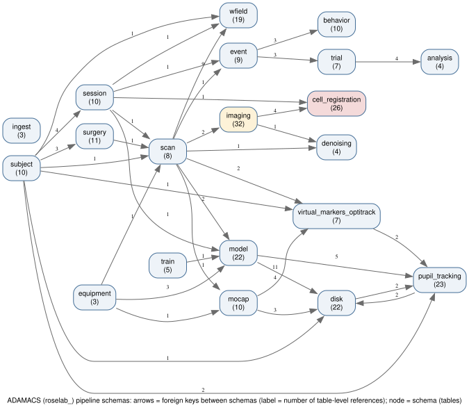

**Every recording is keyed by the same chain:**

```
subject.Subject ─► session.Session (session_id) ─► scan.Scan (scan_id) ─► … modality-specific tables
```

* `session_id` and `scan_id` are the join anchors across modalities.
* Below `imaging.Fluorescence`, always restrict **`paramset_idx` and `curation_id`** explicitly. Mixing curations
  implicitly is the most common silent error.
* "Latest curation" is not a stable selector: a new curation changes it.

| Schema | Comes from | Role |
|---|---|---|
| `subject` | `adamacs/schemas/subject.py` | animals, lines, genotypes, users, projects |
| `surgery` | `adamacs/schemas/surgery.py` | implants, injections, anatomical locations |
| `session` | `element_session` (`session_with_id`) | sessions, users, directories, notes, **same-site groups** (`SessionSite`, `SessionSameSite`) |
| `equipment` | `adamacs/schemas/equipment.py` | rigs and devices |
| `scan` | `element_calcium_imaging.scan` (fork) | scans, scan metadata, paths, channels |
| `imaging` | `element_calcium_imaging.imaging` (fork) | suite2p/CaImAn processing, curation, segmentation, fluorescence, activity, **stored dF/F0**, CASCADE |
| `train`, `model` | `element_deeplabcut` | DLC model training and pose estimation (`*New` chain is scan-keyed and worker-populated) |
| `event`, `trial` | `element_event` (fork) | behaviour recordings, events (≈ 1 billion rows), trials, trial attributes |
| `behavior` | `adamacs/schemas/behavior.py` | HARP, treadmill, synchronised behaviour streams |
| `analysis` | `adamacs/schemas/analysis.py` | behaviour latency measures |
| `pupil_tracking` | `adamacs/schemas/pupil_tracking.py` | pupil ellipses, gaze reconstruction |
| `denoising` | `adamacs/schemas/denoising.py` | SUPPORT denoising tasks before suite2p |
| `mocap`, `virtual_markers_optitrack` | `adamacs/schemas/mocap.py`, `virtual_markers_optitrack.py` | OptiTrack motion capture and derived rigid-body markers |
| `disk` | `adamacs/schemas/disk.py` | DISK imputation of missing keypoints (DLC, head-fixed, top camera, mocap) |
| `wfield` | `adamacs/schemas/wfield.py` | widefield imaging: registration, SVD, CCF alignment, region activity |
| `cell_registration` | `adamacs/schemas/cell_registration.py` | **cross-session cell identity (CellReg)**, live since 2026-10-20 |
| `ingest` | `adamacs/schemas/ingest.py` | ingest run log |
| `responsiveness` | `adamacs/schemas/responsiveness.py` | QC, stimulus responsiveness (ZETA, PSTH read-outs), grating tuning, cell rules. **Piloted, not deployed.** |

Project schemas that live elsewhere (for example `roselab_leondrift`, the drift project) are not documented here.
Several empty `roselab_*` schemas with truncated names (`roselab_imagin`, `roselab_imaging__activit`, …) are
residue of earlier activations with wrong names. They hold no tables.

### `subject`
Animal-level identity and metadata: subjects, lines, genotypes, users, projects, the lab. Everything downstream joins
to `subject.Subject`. Note: importing `adamacs/schemas/subject.py` inserts the lab row (`skip_duplicates`).

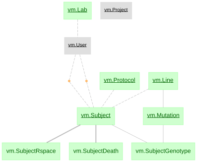

### `surgery`
Surgeries, implants, injections and anatomical coordinates that give a recording its location.

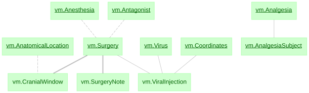

### `session`
Sessions keyed by `session_id`, with users, directories, notes and RSpace links. `SessionSite` / `SessionSameSite`
group the sessions of one chronically imaged field of view. They are the authority that `cell_registration` keys on.

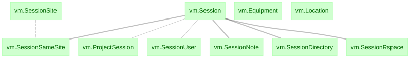

### `equipment`
Rigs and devices, referenced by scans and recordings.

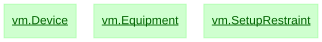

### `scan`
One row per imaging scan (`scan_id`), with acquisition metadata (`ScanInfo`: frame rate, frames, fields), file
paths, channels and location.

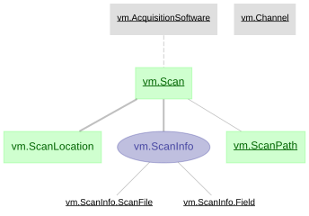

### `imaging`

Calcium-imaging processing, from the SFB1089 fork of element-calcium-imaging:

```
ProcessingTask ─► Processing ─► Curation ─► MotionCorrection ─► Segmentation(.Mask) ─► MaskClassification
                                                             └► Fluorescence(.Trace) ─► Activity(.Trace)
```

* **`Fluorescence.Trace`** holds the raw `fluorescence` and `neuropil_fluorescence` per mask (3.6 M traces).
* **`Activity.Trace`** holds the derived traces per `extraction_method`: `suite2p_deconvolution`, and the CASCADE
  methods `cascade_inference`, `cascade_inference_25ms_filter` and `cascade_inference_global_causal` (plus 6 legacy `cascade_inference_no_neuropil` activities, which the new code no longer computes).
* **`Segmentation.Mask.roi_group`** is a legacy cross-session id that CellReg ingest overwrites in place. Do not key
  analyses on it; use `cell_registration`.

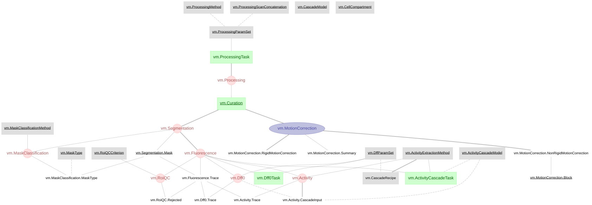

#### Stored dF/F0 and CASCADE (element-calcium-imaging `roselab-0.1.0b1`, live since 2026-11-15)

**What changed.** Until November 2026, dF/F0 was computed inside `Activity.make` for CASCADE and thrown away. Its
parameters were rules on the extraction-method name, and the deployed code had been edited in place. Now dF/F0 is a
stored, parameterised table and CASCADE reads it.

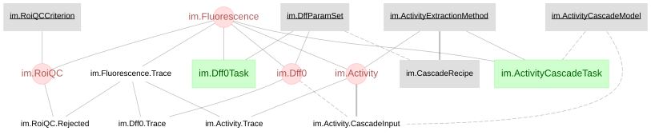

| Table | Tier | What it holds |
|---|---|---|
| `DffParamSet` | Lookup | **One row per dF/F0 recipe**, one typed column per step: dark signal (`none` / fixed `frames` / `shutter` window with fallback frames), neuropil factor and offset (`none` / `median` / `mean`), detrending, baseline (`running_percentile` / `maximin` / `global_percentile`), F0 floor. Recipes are validated and hashed (`dff_hash` unique). Numeric columns are `double`, so the hash survives a round trip. 10 recipes (see below). |
| `CascadeRecipe` | Lookup | Which recipe each CASCADE extraction method uses. `cascade_inference`, `cascade_inference_25ms_filter`, `cascade_inference_global_causal` → recipe 2. **Methods without a row are not computed.** |
| `Dff0Task` | Manual | dF/F0 asked for outside CASCADE (analyses, notebooks): curation × recipe |
| `Dff0` | Computed | One row per curation × recipe: frame rate, dark value and the dark window actually used (`dark_source` = `shutter` / `frames` / `fallback_frames` / `none`), the number of masks with F0 ≤ 0, `element_version`, compute time |
| `Dff0.Trace` | Part | `dff` (float32, `blob@external-raw`), `f0_median`, `f0_min`, `f0_nonpositive` per mask |
| `Activity.CascadeInput` | Part | For every CASCADE activity computed by the new code: the exact `Dff0` (foreign key), the model, the Cascade commit, `element_version`, the time |

**The recipes** (`element_calcium_imaging.dff.KNOWN_RECIPES`):

| idx | Recipe |
|---|---|
| 1 | proposed lab standard = recipe 2 with F0 ≤ 0 flagged |
| 2 | **what CASCADE uses**: shutter-window dark (fallback frames 12–24), neuropil 0.7 + 0.7·median(Fneu), running 8th percentile over 60 s, no floor. Identical to the lab helper with CASCADE settings. |
| 3, 5 | legacy CASCADE before 2026-09-03 (dark frames 12–24; percentile 8 / 11) |
| 4 | legacy p11 after 2026-09-03 |
| 6, 7 | legacy no-neuropil variants (p8 / p11) |
| 8, 9 | the leondrift `dff` / `dff_np` (Bauer 2024 style) recipes |
| 10 | suite2p convention (maximin baseline) |

**How to use it:**

```python
dff = imaging.Dff0.Trace & curation_key & {"dff_paramset_idx": 2}          # read dF/F0, do not recompute it
imaging.Dff0Task.insert1({**fluorescence_key, "dff_paramset_idx": 2, "task_owner": "XX"})   # ask for one
imaging.DffParamSet.insert_new_params(11, "my variant ...", **params)       # a new variant = a new recipe
(imaging.Activity.CascadeInput & activity_key).fetch1()                     # what produced a CASCADE trace
```

* **dF/F0 is computed automatically** for every curation with a pending CASCADE task, by the CASCADE worker.
  `Dff0.key_source` would also offer curations whose activities already exist. Backfilling those (about 0.38 TB for all
  CASCADE curations) is a separate decision, not something a worker does.
* **CASCADE activities written before 2026-11-15 have no `CascadeInput` row.** Date them by the external-store
  timestamp of their traces (dj.Schema('roselab_imaging').external['external-raw']): rows written before
  2026-09-03 15:22 used dark frames 12–24 (recipe 3); later ones used the shutter window (recipe 2).
  `responsiveness.legacy_cascade_recipe(activity_key)` returns that answer (a query, nothing stored).
* **One implementation.** The computation is `element_calcium_imaging/dff.py`. `adamacs.responsiveness.dff0`
  re-exports it, and `adamacs.helpers.stack_helpers.calculate_dFF` wraps it. That wrapper is deprecated and keeps its
  historical defaults (0.3 / 120 s / p15), which are not the CASCADE recipe.
* **Verification.** Re-running CASCADE on recipes 2 and 3 reproduces the stored `cascade_inference`, `_25ms_filter` and
  `_global_causal` traces to float precision, except at masks with F0 ≤ 0 (adamacs_ingest PR #25).
  The `cascade_inference_11` / `_no_neuropil_11` rows did not match their masks and were deleted on 2026-11-15.

Design and decisions: `docs/DFF0_IN_ACTIVITY_MAKE_PROPOSAL.md`.

#### ROI QC (element-calcium-imaging `roselab-0.1.0b2`, live since 2026-11-19)

`RoiQCCriterion` (Lookup: one row per reason to reject an ROI) and `RoiQC` (+ part `Rejected`: per curation × criterion,
the rejected ROIs). The first criterion, `empty_f`, marks ROIs whose fluorescence is 0 in every frame: suite2p leaves
pixels shared with other ROIs out of F, so a fully overlapped ROI has no signal of its own and its dF/F0, CASCADE and
suite2p traces are neuropil. 61,511 of 3.65 M ROIs (1.7 %) in 1,615 of 3,250 curations. New `Dff0` / CASCADE rows are
NaN for them; **rows stored before 2026-11-19 are not, so exclude `imaging.RoiQC.Rejected.proj()` in queries.**
Usage: `docs/ROI_QC.md`.

### `train` and `model` (DeepLabCut)
Model training (`train`) and pose estimation (`model`). Only the scan-keyed `*New` chain
(`VideoRecordingNew → PoseEstimationTaskNew → PoseEstimationNew`) is worker-populated and feeds `pupil_tracking`. The
legacy session-keyed chain joins to nothing scan-keyed.

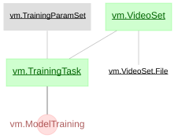
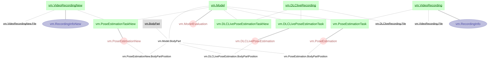

### `event`
Behaviour recordings and timestamped events on the DAQ clock: stimulus presentations, Bpod states, 2P frame
(`bench2p_frames`) and shutter times.
* **Stimulus identity is written into `event_type`**, e.g. `Moving_Gratings:210;Moving_Gratings;…`.
* `EventType` is a Lookup holding over 160 000 rows (instance-like labels).

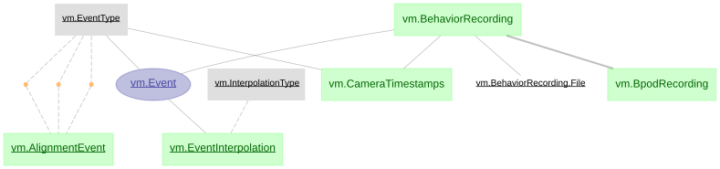

### `trial`
Trials, trial types, attributes and the trial ↔ event link. **"Trial" means different things by ingest path:**
* bench2p visual stimulation: one repeat block, every stimulus once. For natural images: a single trial for the whole
  session.
* Bpod tasks: one task trial, with the condition in `trial_type` and outcomes in `Trial.Attribute`.
* Oddball / VR corridor: one corridor run.

`Block` is declared but empty.

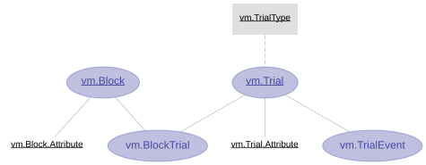

### `behavior`
HARP, treadmill and other synchronised behaviour streams.

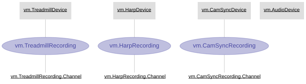

### `analysis`
Behaviour latency measures (time to target, port latencies, trial durations).

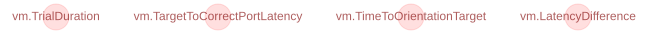

### `pupil_tracking`
Pupil ellipse fits and gaze reconstruction from the eye cameras, linked to the DLC `*New` chain and to mocap.

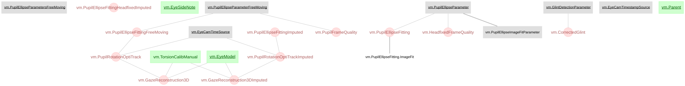

### `denoising`
SUPPORT denoising tasks and parameter sets. Denoised data feed suite2p processing sets with `paramset_idx >= 1000`.
Insert a `DenoisingTask` before the downstream `ProcessingTask`.

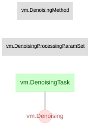

### `mocap` and `virtual_markers_optitrack`
OptiTrack recordings and trajectories, and the derived rigid-body / virtual-marker reconstruction used for head pose
and gaze.

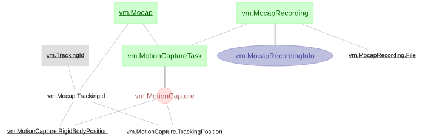
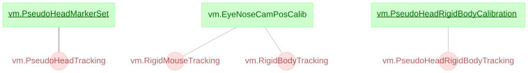

### `disk`
DISK imputation of missing keypoints, with task and result tables per source (DLC, head-fixed, top camera, mocap),
models and parameter sets.

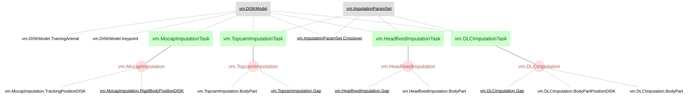

### `wfield`
Widefield imaging:
* processing tasks and runs;
* blue/violet registration;
* SVD decomposition, FOV masks;
* hemodynamic correction and normalisation methods;
* CCF atlas alignment (references, landmarks, region masks), retinotopic references and region-averaged activity.

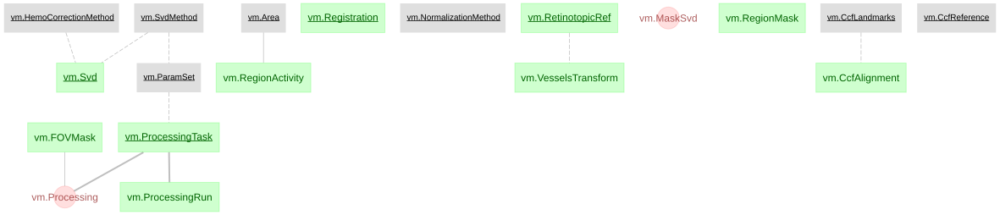

### `cell_registration`

**Cross-session cell identity with CellReg, live since 2026-10-20.** Longitudinal imaging rests on the claim "this
cell on day 20 is that cell on day 0". The old carrier of that claim, `Segmentation.Mask.roi_group`, is overwritten
in place by whichever CellReg ingest ran last, and records no run, parameters or match quality. This schema makes
identity a versioned, queryable entity.

**Design principles** (full review: `adamacs/schemas/CELL_REGISTRATION_SCHEMA_DESIGN_REVIEW.md`):
* **Strictly additive.** `roi_group` is never written. `RoiGroupSnapshot` preserves its state, and
  `RoiGroupProjection` is the only table that would write it; nothing calls it.
* **Per-session mask ids are the anchor:** `(session_id, scan_id, paramset_idx, curation_id, mask)`.
* **Runs are content-addressed** by the sha256 of their result file, so backups of the same run collapse to one row.
* **Quality is stored as rows with columns, not blobs** (per cell, per pair). **Thresholds live downstream.**
* **Sites are the lab's own same-site groups.** `RegistrationSite` takes a foreign key to `session.SessionSite`
  (ADR-R8, 2026-11-03; `adamacs/schemas/DESIGN_NOTE_samesite_key.md`).
* **Nothing is declared on import** (deferred `activate()`).

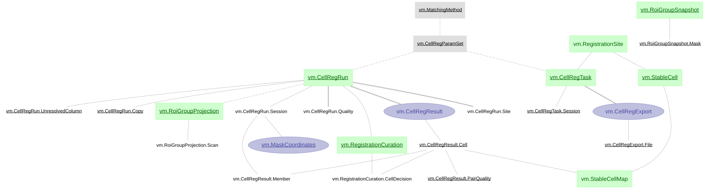

Entity–relationship diagram, parsed from the schema source:


| Table | Tier | What it holds |
|---|---|---|
| `MatchingMethod` | Lookup | how cells were matched (a new method is a row, not a migration) |
| `CellRegParamSet` | Lookup | immutable, content-hashed CellReg parameters (`.register()`) |
| `RegistrationSite` | Manual | a field of view followed over days = the lab's `same_site_id` |
| `CellRegTask` | Manual | one **planned** run over an explicit, **ordered** set of curations (the columns) |
| `CellRegExport` | Imported | what a trigger task wrote (inputs for MATLAB) or what a load task found |
| `CellRegRun` | Manual | one CellReg execution, identified by its result file's content |
| `CellRegResult` | Imported | the parsed result: `.Cell` (scores, presence), `.Member` (cell ↔ mask per session), `.PairQuality` (p_same per pair) |
| `MaskCoordinates` | Imported | mask centroids in the scan's frame and after the run's alignment |
| `RegistrationCuration` | Manual | append-only human decisions per registered cell (accept / reject / split / merge / uncertain) |
| `StableCell`, `StableCellMap` | Manual | identities that outlive a single run, mapped onto each run's cells |
| `RoiGroupSnapshot`, `RoiGroupProjection` | Manual | read-only snapshots of `roi_group`; the (unused) projection onto it |

**Workflow:** plan → declare a `CellRegTask` → export inputs → MATLAB CellReg on ibehaveGPU1 → register the run →
parse → verify → curate.


* **Code:** `adamacs/ingest/cellreg*.py`, `adamacs/workers/cellreg_worker.py`, `adamacs/matlab/cellreg_run.m`,
  launcher `scripts/cellreg_worker_ibehavegpu.sh`.
* **Notebooks:** 17 (parse, query, worked example), 18 (trigger: edit one cell, run the rest), 19 (plain-words tour).
* **Rules:**
  * **CellReg must not run on TATCHU3.** A run once exhausted its RAM and took the database server down.
  * The worker is a dry run unless given `--execute`.
  * Declaring a task, exporting, registering and ingesting are all writes.
* **Full workflow and traps:** `skills/cellreg/SKILL.md`.

### `responsiveness` (not yet deployed)

Module: `adamacs/schemas/responsiveness.py` (deferred `activate()`, upstream modules passed in) · worker
`adamacs/workers/responsiveness_worker.py` (ibehaveGPU1, env `datajoint_ingest`) · design
`docs/RESPONSIVENESS_SCHEMA_PROPOSAL.md` · guided tour on pilot data `notebooks/responsiveness_v8_tour.ipynb`
(generated by `scripts/make_responsiveness_tour.py`).
* **Two levels.** Event-independent QC (`ScanQuality`: detector gain from shutter-closed dark frames; `Quality`:
  neuropil sweep, kurtosis, photons/s; `TraceQuality`: SNR, noise, event rate) and event-dependent responses
  (`Readout`: PSTH read-outs per onset; `Zeta`: time-series ZETA). Stimulus-specific follow-ups read `Readout`
  (`DirectionTuning`: Mazurek et al. 2014 orientation / direction measures).
* **Keys are inherited.** Curation (`imaging.Fluorescence`) + `trace_source` (dF/F0 recipe or extraction method:
  CASCADE 25 ms, OASIS) + per cell `mask, fluo_channel`; event-dependent rows add `event_selector` and their own
  parameter set, so variants coexist.
* **Onsets come from the trial schema.** `EventSet.Onset` rows are `trial.TrialEvent` rows; `EventSelector` holds the
  paradigm rule (gratings, natural images, RF checkerboard, Bpod trial types, random-onset controls).
  `ScreenTiming` adds the photodiode onset where the rig has one (else a 0.1 s default latency).
* **Explicit windows.** Each read-out window has a start and an end anchored to stimulus onset or offset (s or
  frames); the resolved edges are stored. Standard windows: gratings read-out 16 (stimulus on screen, raw trial
  values, baseline frames [on − 60, on − 10) for the test); images read-out 3 (OASIS, Leon's export) and 11 (CASCADE,
  v1-drift-audit consensus), with ZETA for responsiveness.
* **ZETA on the read-out epoch.** `Zeta` is keyed on `Readout`: its window is that read-out's epoch (baseline start to
  response end, or the response window only), so ZETA compares across epoch settings. On gratings, ZETA on read-out
  16's epoch is calibrated (≈ 4 % on random onsets) where the audit's window (onset to next onset) gives 13 %.
* **Direction.** `Readout.Cell.resp_delta` (response − baseline) and `resp_vs_trace` (response − trace mean);
  `CellRule.direction` and the `<rule>_pos` rules keep activated cells only; `cells()` returns `is_positive`.
* **Thresholds are rows** (`CellRule`) applied by query (`cells(rule)`). Standard rules: `gratings_cascade25`,
  `gratings_oasis` (read-out 16 p < 0.05, oracle >= 0.18) and `images_cascade25`, `images_oasis` (ZETA p < 0.05,
  oracle >= 0.08); oracle thresholds = 95th percentile of a label-shuffle null.
* **Pilot:** `tobiasr_responsiveness_v7` and `_v8`, 10 recordings of 8 animals; ZETA agrees with the v1-drift-audit (rank r
  0.955–0.991), read-out 2 and `DirectionTuning` reproduce the audit's grating export and tuning.
* **`activate()` refuses** an `imaging` schema that lacks `Dff0`.

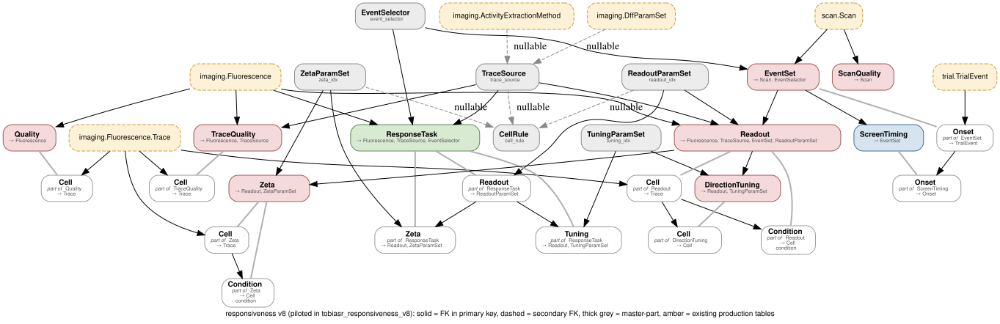

### `ingest`
`IngestRun`: one row per ingest run (who, where, from which commit, how it ended).

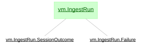

### Regenerating the diagrams

```bash
cd ~/adamacs                                    # a directory with dj_local_conf.json
conda activate cellreg                          # any env with datajoint, graphviz (python) and dot
python ~/adamacs_ingest/scripts/draw_schema_diagrams.py
```

The script is read-only: it sets `transaction_read_only` and uses virtual modules, and it never imports
`adamacs.pipeline`. Only `notebooks/schema_diagrams/*.svg` is tracked; other `*.svg` / `*.png` are git-ignored.
Troubleshooting: `docs/DIAGRAM_SETUP.md`.

---

## Servers, environments and workers

| Host | Role |
|---|---|
| **TATCHU3** | MySQL server, blob store (`/datajoint-db`), data share (`/datajoint-data`), CPU population worker, wfield worker |
| **ibehaveGPU1 = BUGPU** | GPU workers: CASCADE, SUPPORT denoising, DLC; CellReg (MATLAB) |

**Which `adamacs` an environment imports** (checked 2026-11-15):

| Envs | `import adamacs` resolves to |
|---|---|
| Python 3.8 envs (`datajoint`, `datajoint_server`, `cellreg`, `allen-gaze` on TATCHU3; `Cascade`, `cellreg`, `datajoint`, `dimred`, `support`, `v1audit` on BUGPU) | `~/adamacs` (SFB1089/adamacs, egg-link) |
| Python 3.11 envs (`datajoint_analysis`, `leondrift` on TATCHU3; `datajoint_analysis`, `datajoint_ingest` on BUGPU) | `~/adamacs_ingest` (this repo, editable) |

* **The production workers import `~/adamacs`.** The CellReg worker and notebooks 17–19 need `~/adamacs_ingest`.
* **The element is the same everywhere.** All 14 envs carry `element-calcium-imaging` `roselab-0.1.0b1`
  (`element_version` `34c149174f+769a517d5443`, files byte-identical to the tag). No shadowing copies on `sys.path`.

**Workers:**

| Worker | Host / env | Populates |
|---|---|---|
| `SOPs/Serverscripts/populate_tables.py` | TATCHU3 / `datajoint` | imaging chain up to `Activity` **for keys without a CASCADE task**, mocap |
| `SOPs/Serverscripts/populate_tables_cascade.py` | BUGPU / `Cascade` | `imaging.Dff0` (only for curations with a pending CASCADE task), then `imaging.Activity` (CASCADE) |
| `SOPs/Serverscripts/populate_tables_denoise.py` | BUGPU / `support` | `denoising` |
| `adamacs/workers/cellreg_worker.py` | BUGPU / `cellreg` (manual, `scripts/cellreg_worker_ibehavegpu.sh`) | CellReg exports, MATLAB runs, result registration |

The cron watchdogs (`check_and_start_population_process*.sh`) restart a worker that is not running.
**After a pip upgrade, restart every long-running worker:** a running process keeps the old code in memory.

---

## Releasing changes to the SFB1089 element fork

1. Change `SFB1089/element-calcium-imaging` in a PR. Add tests (`tests/test_dff.py`), bump `version.py` and update
   `CHANGELOG.md`.
2. After the merge, tag it: `git tag -a roselab-<version> && git push origin roselab-<version>`.
3. Install the tag in **every** env on both hosts, without touching other packages:
   ```bash
   ~/miniconda3/envs/<env>/bin/python -m pip install --no-deps "git+https://github.com/SFB1089/element-calcium-imaging.git@roselab-<version>"
   ```
   Find the envs with `ls -d ~/miniconda3/envs/*/lib/python3*/site-packages/element_calcium_imaging-*`.
4. **Installing declares new tables.** The next process that imports the pipeline creates the tables the new code has,
   and inserts Lookup contents, so get schema changes approved before step 3.
5. **Restart the workers.**
6. **Never edit installed element files in place.** `element_version` (commit + hash of `imaging.py`/`dff.py`) is
   stored on every new `Dff0` / CASCADE row and exposes in-place edits.

---

## Rules for working on the production database

* **Read-only by default.** Inspect through virtual modules, with a server-side guard:
  ```python
  import datajoint as dj
  dj.conn().query("SET SESSION transaction_read_only = 1")
  imaging = dj.create_virtual_module("imaging", "roselab_imaging", create_schema=False, create_tables=False)
  ```
  **Do not `import adamacs.pipeline` to look at data:** it declares missing tables and inserts lookup rows.
* **Use DataJoint calls** (restriction, join, `proj`, `aggr`, `fetch`), not raw SQL.
* **Never delete, drop, update or clear jobs without explicit approval** in that conversation. Inserts with
  `skip_duplicates=True` are fine.
* **Never write or delete files under `/datajoint-db` or `/datajoint-data`.**
* **Restrict `paramset_idx` and `curation_id` explicitly** at and below `imaging.Fluorescence`.
* **Notes for agents and newcomers** live in `~/adamacs/notebooks/tobiasr/Claude/<task>/` (handoff + learnings with
  evidence tags), e.g. `dff0-cascade/`, `Cascade/`, `drift-reanalysis/`.

---

## Local checks and CI parity

```bash
python -m pip install pytest ruff
python -m ruff check --select E9,F63,F7,F82 adamacs tests examples
python -m pytest -q
```

CI runs lint and pytest on Python 3.11, with pytest and numpy only. Tests that need DataJoint, scipy or the element
skip themselves.

## `adamacs_analysis` class generation utility

```bash
python -m pip install -e ../adamacs_analysis
adamacs-analysis-generate --schema-name adamacs_analysis --output generated/my_analysis_schema.py \
  --class TrialLevelMetrics:Computed --class SubjectSummary:Manual
```

---

## Further documentation

| Topic | Where |
|---|---|
| dF/F0 in `imaging`, CASCADE provenance | `docs/DFF0_IN_ACTIVITY_MAKE_PROPOSAL.md` |
| Responsiveness design (events, ZETA, tuning, rules) | `docs/RESPONSIVENESS_SCHEMA_PROPOSAL.md` |
| Cell registration design review | `adamacs/schemas/CELL_REGISTRATION_SCHEMA_DESIGN_REVIEW.md`, `adamacs/schemas/DESIGN_NOTE_samesite_key.md`, `skills/cellreg/SKILL.md` |
| Ingest logging | `docs/INGEST_LOGGING.md` |
| Notebook index, batch ingest | `docs/NOTEBOOK_INDEX.md`, `docs/BATCH_INGEST_EXAMPLES.md` |
| Student workflow | `docs/STUDENT_WORKFLOW.md` |
| Split audit, path migration | `docs/SPLIT_AUDIT.md`, `MIGRATION.md` |
| Tobiasr notebook adaptation / catalogue | `docs/TOBIASR_INGEST_ADAPTATION.md`, `docs/TOBIASR_NOTEBOOK_CATALOG.md` |
| Diagram setup | `docs/DIAGRAM_SETUP.md` |

**External references:**
* DataJoint core <https://docs.datajoint.com/core/datajoint-python/latest/>
* Elements <https://docs.datajoint.com/elements/>: Calcium Imaging
  <https://docs.datajoint.com/elements/element-calcium-imaging/latest/>, DeepLabCut
  <https://docs.datajoint.com/elements/element-deeplabcut/latest/>, Event
  <https://docs.datajoint.com/elements/element-event/0.2/concepts/>
* Suite2p <https://suite2p.readthedocs.io/en/latest/>
* DeepLabCut <https://deeplabcut.github.io/DeepLabCut/>
* DISK <https://github.com/bozeklab/DISK>
* CASCADE <https://github.com/HelmchenLabSoftware/Cascade>
* CellReg <https://github.com/zivlab/CellReg>
* ADAMACS reference index <https://github.com/trose-neuro/adamacs_documentation/blob/main/docs/common/external_references.md>
