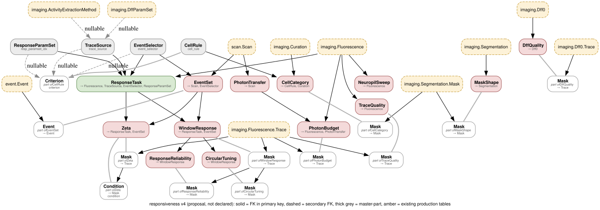

# Responsiveness schema: design v4 (non-redundant), population and BUGPU worker

*Tobias Rose, 15.11.2026. **Status: proposal.** Nothing below is declared. Earlier versions of this document (v1–v3,
with the literature review and the dF/F0 analysis) are in the git history of this file.*

---

## 1. What changed since v3, and the rule applied

**Three things changed:**
* **dF/F0 is now a stored table in `imaging`** (`DffParamSet`, `Dff0`; element-calcium-imaging `roselab-0.1.0b1`).
  CASCADE reads it, and new CASCADE rows carry their provenance in `imaging.Activity.CascadeInput`.
* **zetapy 4.1 is installed on BUGPU** in `datajoint_ingest` (Python 3.11, imports `adamacs_ingest`). The Python 3.8
  worker envs cannot take zetapy 4.x, which needs Python ≥ 3.9.
* **Workers run on BUGPU.**

**The rule for v4: store nothing that is already stored, or derivable, elsewhere.** Every table and column below holds
something no other table holds. §6 lists what v3 had and why it is gone.

**What stays upstream, never copied:**

| Fact | Lives in |
|---|---|
| traces | `imaging.Activity.Trace` (suite2p, CASCADE), `imaging.Dff0.Trace` (dF/F0 per recipe) |
| F0 statistics, F0 ≤ 0 flag, dark window | `imaging.Dff0`, `imaging.Dff0.Trace` |
| cell type | `imaging.MaskClassification.MaskType` |
| onset times, stimulus strings | `event.Event` |
| trials, trial attributes | `trial.Trial`, `trial.Trial.Attribute`, reached through `trial.TrialEvent` |
| frame times, frame rate | `event.Event` (`bench2p_frames`), `scan.ScanInfo` |
| cross-session identity | `cell_registration.CellRegResult.Member` |
| provenance of legacy CASCADE rows | **derivable** from the external-store timestamp, so a helper function, not a table |

---

## 2. The tables (12 + parts)

```
 TRACE & EVENT DEFINITIONS (Lookup)         WHAT TO COMPUTE (Manual)       RESULTS (Computed)
 TraceSource ──┐                                                           ┌─► TraceQuality(.Mask)          ACTIVE
 EventSelector ┼──────────────► ResponseTask ◄── imaging.Fluorescence      ├─► EventSet(.Event) ─┐
 ResponseParamSet ┘                     │                                  │                     │
                                        └──────────────────────────────────┼─► Zeta(.Mask, .Condition)    RESPONSIVE / SPECIFIC
                                                                           ├─► WindowResponse(.Mask)       RESPONSIVE / SELECTIVE / RELIABLE
                                                                           │      └─► CircularTuning(.Mask) TUNED (circular axes only)
 CellRule(.Criterion) ─────────────────────────────────────────────────────┴─► CellCategory(.Mask)         DECISION
```



### 2.1 Definitions (Lookup)

```python
@schema
class TraceSource(dj.Lookup):
    definition = """
    # A trace type responses are computed on: exactly one of an imaging activity method or a dF/F0 recipe
    trace_source         : varchar(24)    # 'dff0', 'cascade25', 's2p'
    ---
    -> [nullable] imaging.ActivityExtractionMethod
    -> [nullable] imaging.DffParamSet
    """
    contents = [("dff0", None, 2), ("cascade25", "cascade_inference_25ms_filter", None),
                ("s2p", "suite2p_deconvolution", None)]
```
DataJoint has no union foreign key. This is the standard way to express one: two nullable foreign keys, with a check
on insert that exactly one is set. There is no free-text description column: the foreign keys are the description.

```python
@schema
class EventSelector(dj.Lookup):
    definition = """
    # A rule that picks response onsets from event.Event and labels their condition. Never edited.
    event_selector       : varchar(48)    # 'gratings', 'gratings_random', 'nat_images_repeated', 'cricket_cue'
    ---
    event_type_like      : varchar(128)   # the onset events (for task trials: the alignment event, e.g. 'bpod_cue')
    trial_type_like=''   : varchar(128)   # optional: keep only events inside trials of this type (via trial.TrialEvent)
    condition_from       : enum('none','event_type','trial_type','trial_attribute')
    condition_name=''    : varchar(32)    # 'direction', 'image_id', ... or the trial attribute's name
    parser='none'        : varchar(32)    # registered function turning the source text into the condition label
    circular_period=null : float          # [deg] 360 for direction: CircularTuning applies
    random_seed=null     : int            # set = no-stimulus control: same number of onsets at seeded random times
    filter=null          : longblob       # optional: {'min_repeats': 6}, {'block_parity': 'odd'}, {'attribute': {...}}
    """
```
**Every onset is an `event.Event` row.** For task trials it is the alignment event inside the trial (e.g. `bpod_cue`),
and the trial is reachable through `trial.TrialEvent`. So `EventSet` needs no trial part and no copied times. A
**random** selector stores nothing: its onsets are a deterministic function of the seed, the scan's frame clock and
the reference count.

```python
@schema
class ResponseParamSet(dj.Lookup):
    definition = """
    # Settings of one response method. Same settings -> same row (hash unique). Never edited.
    resp_paramset_idx    : smallint
    ---
    method               : enum('zeta','window')
    resp_hash            : uuid
    unique index (resp_hash)
    params               : longblob       # zeta:   {'window': 'median_ioi', 'resampling': 100, 'jitter': 2, 'edge': 'drop',
                                          #          'per_condition': True, 'vs_rest': True}      (False/False = audit t73)
                                          # window: {'resp_s': [0.1, 0.6], 'base_s': [-0.3, 0], 'n_perm': 1000, 'n_boot': 1000}
    """
```

### 2.2 What to compute (Manual)

```python
@schema
class ResponseTask(dj.Manual):
    definition = """
    # Compute this method on this trace type of this curation for these onsets. Staged by people (helper), populated by the worker.
    -> imaging.Fluorescence
    -> TraceSource
    -> EventSelector
    -> ResponseParamSet
    ---
    task_owner           : varchar(32)
    """
```
A helper `plan_tasks(restriction, trace_sources, selectors, paramsets, owner)` inserts tasks. It refuses tasks whose
trace does not exist: no `imaging.Activity` row for the method, or no `imaging.Dff0` row for the recipe (in that case
it inserts the `imaging.Dff0Task`, so dF/F0 is computed first).

### 2.3 Results (Computed)

```python
@schema
class EventSet(dj.Computed):
    definition = """
    # The onsets an EventSelector picks in one scan
    -> scan.Scan
    -> EventSelector
    ---
    n_onsets             : int
    n_conditions         : smallint
    """
    class Event(dj.Part):                 # empty for random selectors (onsets regenerated from the seed)
        definition = """
        -> master
        -> event.Event
        ---
        condition            : varchar(32)    # parsed label ('all' if condition_from = 'none')
        """
    # key_source = (scan.Scan * EventSelector) & ResponseTask
```
The parsed `condition` is the only stored derivative here, because parsing is the fragile step and must be fixed per
set. Onset times and order come from `event.Event`.

```python
@schema
class TraceQuality(dj.Computed):
    definition = """
    # Event-independent activity and quality of every dF/F0 trace (ACTIVE level)
    -> imaging.Dff0
    """
    class Mask(dj.Part):
        definition = """
        -> master
        -> imaging.Dff0.Trace
        ---
        noise_nu             : float      # [%/sqrt(Hz)] CASCADE noise level of dF/F0
        snr_peak             : float      # 99th percentile of dF/F0 / robust noise SD
        skewness             : float
        event_rate           : float      # [1/min] transients > 3 x robust noise SD
        neuropil_ratio       : float      # median Fneu / median F
        """
    # key_source = imaging.Dff0 & (ResponseTask * TraceSource): only recipes some task uses
```

```python
@schema
class Zeta(dj.Computed):
    definition = """
    # Time-series ZETA (zetapy) for every trace of one task (RESPONSIVE: pooled; SPECIFIC/SELECTIVE: per condition)
    -> ResponseTask                       # method = 'zeta'
    -> EventSet
    ---
    window_s             : float          # [s] resolved window (median onset-to-onset interval)
    n_onsets_used        : int            # after dropping onsets whose jitter window leaves the recording
    software             : varchar(64)    # 'zetapy 4.1 | adamacs_ingest <commit>'
    """
    class Mask(dj.Part):
        definition = """
        -> master
        -> imaging.Fluorescence.Trace
        ---
        zeta_p               : float      # time-locked to the onsets, any response shape?
        zeta_z               : float      # zetapy zeta_score
        latency=null         : float      # [s] time of the largest deviation
        """
    class Condition(dj.Part):             # only if params.per_condition
        definition = """
        -> master.Mask
        condition            : varchar(32)
        ---
        zeta_p               : float      # responds to THIS condition (one-sample ZETA on its onsets)?
        zeta2_p=null         : float      # differs from the other conditions (two-sample zetatstest2)? (params.vs_rest)
        """
```
* The seed is `crc32(scan_id)`, derivable, so it is not stored.
* The number of onsets per condition is derivable from `EventSet.Event`.

```python
@schema
class WindowResponse(dj.Computed):
    definition = """
    # Response- and baseline-window means per onset, and the statistics that rules filter on
    -> ResponseTask                       # method = 'window'
    -> EventSet
    """
    class Mask(dj.Part):
        definition = """
        -> master
        -> imaging.Fluorescence.Trace
        ---
        resp                 : longblob   # (n_onsets,) response-window mean, EventSet.Event order (by event_start_time)
        base                 : longblob   # (n_onsets,) baseline-window mean
        effect_d             : float      # paired Cohen's d (sign = excited/suppressed)
        resp_p               : float      # Wilcoxon resp vs base over all onsets
        cond_p=null          : float      # Kruskal-Wallis across conditions (NULL if one condition)
        splithalf_r=null     : float      # Spearman-Brown split-half reliability of the condition curve
        """
```
* Per-condition means, SEMs and the mean amplitude are derivable from `resp`, `base` and `EventSet.Event`, so they are
  not stored.
* The four statistics are stored because rules filter on them.

```python
@schema
class CircularTuning(dj.Computed):
    definition = """
    # Orientation/direction tuning from WindowResponse, for selectors with a circular condition axis
    -> WindowResponse
    """
    class Mask(dj.Part):
        definition = """
        -> master
        -> WindowResponse.Mask
        ---
        pref_deg             : float      # [deg] preferred direction (first harmonic)
        pref_axis_deg        : float      # [deg] preferred orientation (second harmonic)
        dsi_vec              : float
        osi_vec              : float      # 1 - circular variance
        dsi_perm_p           : float      # label-permutation p of dsi_vec
        osi_perm_p           : float      # label-permutation p of osi_vec (nb37 tuning test)
        pref_ci_width        : float      # [deg] bootstrap 95 % CI of pref_axis_deg
        """
    # key_source = WindowResponse & (ResponseTask * EventSelector & 'circular_period IS NOT NULL')
```
A separate table, so `WindowResponse` carries no columns that are NULL for every non-grating selector.

### 2.4 Decisions

```python
@schema
class CellRule(dj.Lookup):
    definition = """
    # A named set of thresholds. Never edited; a changed threshold is a new rule.
    cell_rule            : varchar(48)
    ---
    decided_by           : varchar(32)
    decided_on           : date
    """
    class Criterion(dj.Part):
        definition = """
        -> master
        criterion            : varchar(32)
        ---
        level                : enum('active','responsive','selective','specific')
        source               : varchar(48)    # 'TraceQuality.Mask', 'Zeta.Mask', 'Zeta.Condition', 'WindowResponse.Mask',
                                              # 'CircularTuning.Mask', 'imaging.MaskClassification.MaskType', 'imaging.Dff0.Trace'
        attribute            : varchar(32)
        op                   : enum('<','<=','>','>=','==')
        threshold            : varchar(32)
        holm=0               : bool           # Holm across conditions within the cell (Condition sources)
        -> [nullable] TraceSource
        -> [nullable] EventSelector
        -> [nullable] ResponseParamSet
        """

@schema
class CellCategory(dj.Computed):
    definition = """
    # One rule applied to one curation
    -> CellRule
    -> imaging.Curation
    """
    class Mask(dj.Part):
        definition = """
        -> master
        -> imaging.Segmentation.Mask
        ---
        is_active=null       : bool       # NULL: the rule has no criterion at this level
        is_responsive=null   : bool
        is_selective=null    : bool
        is_specific=null     : bool
        """
```
* **`CellCategory` is the one deliberate cache.** It is derivable from the measurements and the rule, but storing it
  makes "responsive cells" a restriction that joins to `cell_registration`, and it is deleted with its inputs.
* Counts per curation and the list of passing conditions are derivable (`dj.U().aggr`, `Zeta.Condition`), so they are
  not stored.
* **A level requires the level below it.**

**Removed, now a function:** `legacy_cascade_recipe(activity_key)` returns the dF/F0 recipe of a CASCADE activity
written before `Activity.CascadeInput` existed. It uses the external-store timestamp: before 2026-09-03 15:22 → recipe
3 (dark frames 12–24), after → recipe 2. This replaces the v3 tables `responsiveness.CascadeInput` and
`CascadeRecompute`. The recomputation evidence stays in adamacs_ingest PR #25 and `docs/DFF0_IN_ACTIVITY_MAKE_PROPOSAL.md`.

---

## 3. Population: who computes what, and in which order

| Table | Inputs it waits for | Cost | Computed by |
|---|---|---|---|
| `imaging.Dff0` | `Dff0Task` (inserted by `plan_tasks` when a task uses `dff0`) or a pending CASCADE task | CPU, minutes per curation | CASCADE worker (pending CASCADE tasks), else the responsiveness worker |
| `EventSet` | `ResponseTask` for the scan | seconds | responsiveness worker |
| `TraceQuality` | `Dff0` used by a task | seconds per curation | responsiveness worker |
| `WindowResponse` | `EventSet` + trace (`Activity` or `Dff0`) | seconds | responsiveness worker |
| `CircularTuning` | `WindowResponse` | seconds (permutations, bootstrap) | responsiveness worker |
| `Zeta` | `EventSet` + trace | **dominant**: masks × (1 + conditions) × resamples | responsiveness worker, parallel over masks |
| `CellCategory` | every source a rule names | seconds | responsiveness worker |

**`key_source` does the ordering.** Each table's `key_source` requires its inputs, so a single loop that populates the
tables in the order above never computes from missing inputs. People only insert `ResponseTask` rows (and, rarely,
`CellRule` rows). The worker computes everything else.

---

## 4. The BUGPU worker

| | |
|---|---|
| Code | `adamacs/workers/responsiveness_worker.py` in `adamacs_ingest` (next to `cellreg_worker.py`) |
| Host / env | ibehaveGPU1, `datajoint_ingest` (Python 3.11, zetapy 4.1, element `roselab-0.1.0b1`, imports `adamacs_ingest`) |
| Working dir | **`~/adamacs_ingest`**: has `dj_local_conf.json`. Starting from `~` imports `~/adamacs` as a namespace package. |
| Start | `SOPs/Serverscripts/check_and_start_population_process_responsiveness.sh` from cron (`*/10`), same pattern as the other workers; log `~/logs/responsiveness_worker.log` |
| Loop | `EventSet → TraceQuality → WindowResponse → CircularTuning → Zeta → CellCategory`, each `populate(reserve_jobs=True, suppress_errors=True, order='random', limit=…, max_calls=1)`, then a 30 s sleep when nothing was pending |
| Parallelism | one worker process. Inside `Zeta.make`, masks are spread over a process pool (`n_procs`, default 24, single-threaded BLAS). Other makes are single-process. |
| CPU etiquette | `nice -n 10`; `n_procs` capped by `os.cpu_count() - 32`; BUGPU also runs the CASCADE (GPU), denoise (GPU) and DLC workers |
| Never | no deletes, no job-table clears (proposed to Tobias), no writes outside `roselab_responsiveness` except `imaging.Dff0Task` inserts and `imaging.Dff0` populates |
| Versions | `Zeta.software` records zetapy + the git commit of `adamacs_ingest`; the worker refuses to start on a dirty checkout |
| Stop | SIGTERM is caught between iterations. Inside a `make`, DataJoint turns SIGTERM into an error job, so stop the worker only when the jobs table shows no reservation for its pid. |

**Cost estimate:** to be measured on one scan before the first production populate. t73/t140 ran pooled ZETA for
about 10,000 cells × 2 signals on 80 processes in hours. Per-condition ZETA multiplies that by about (1 + number of
conditions).

---

## 5. Build order and checks

1. **Test schema `tobiasr_responsiveness_v4`** (the phase-1 `tobiasr_responsiveness` is obsolete; dropping it needs
   your OK). Lookups + `EventSet` for the drift scans:
   * 180 grating onsets in 12 conditions per scan;
   * repeated-image counts as expected;
   * one Bpod scan (`cricket_cue`).
2. **`Zeta` pooled** on `cascade25` and `s2p`: p-values equal `v1-drift-audit/artefacts/t140/zeta_all.tsv` for the
   same events and seed; random selectors give 5–6 % false positives.
3. **`WindowResponse` + `CircularTuning`:** values equal the leondrift Kruskal and `sub_vec` tuning for the same windows.
4. **`TraceQuality`, `CellRule 'drift2026_v1'`, `CellCategory`:** the cohort sizes reproduce nb37.
5. **Worker:** dry run on the test schema, then time one scan.
6. **Production `roselab_responsiveness` and the cron entry:** only with your OK.

---

## 6. v3 → v4: what was removed and why

| v3 | v4 | Reason |
|---|---|---|
| `Signal` (with description) | `TraceSource` (foreign keys only) | the description duplicated what the foreign key says |
| `EventClass` with `unit`, `kind` | `EventSelector` | every onset is an event (task trials: their alignment event), so `unit` and the trial part went; `random_seed` replaces `kind` |
| `EventSet.onsets`, `.conditions`, `.trial_ids`, `.median_ioi`, `.Trial` part | `EventSet.Event` (link + condition) | times, order and trial ids are in `event.Event` / `trial.TrialEvent`; the window is derivable |
| `TraceQuality.f0_*` | (gone) | already in `imaging.Dff0.Trace` |
| `ZetaTest.meanrate_p`, `.seed`, `Condition.n_onsets` | (gone) | a second mean test duplicates `WindowResponse.resp_p`; seed and counts are derivable |
| `WindowStats.amp_mean`, `frac_pref_sig`, `r2er`, `snr`, `.Condition` | (gone) | derivable from `resp`/`base`, or not used by any rule |
| tuning columns inside `WindowStats` (NULL for non-circular) | `CircularTuning` | no columns that are NULL by design |
| `CellCategory` counts, `specific_to` | (gone) | derivable by aggregation / from `Zeta.Condition` |
| `responsiveness.CascadeInput`, `CascadeRecompute` | `legacy_cascade_recipe()` | derivable from the external-store timestamp; not responsiveness |

---

## 7. Decisions for you

1. **Approve v4 for the test schema** (`tobiasr_responsiveness_v4`), and **dropping the obsolete `tobiasr_responsiveness`**?
2. **First rule `drift2026_v1`** = nb37: soma; ZETA p < 0.05 (pooled, `cascade25` or `s2p`?); orientation-tuned (`osi_perm_p`
   < 0.05) for the selective level. Which trace source is primary?
3. **Per-condition ZETA by default:** only for selectors with ≤ 12 conditions?
4. **The worker's CPU share on BUGPU** (`n_procs` 24?), given the CASCADE, denoise and DLC workers.
