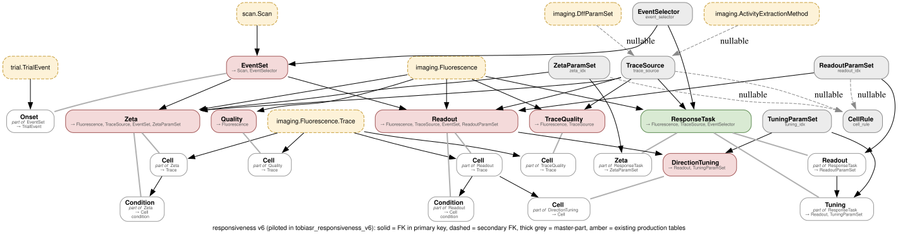

# Responsiveness schema v6: QC, responsiveness and stimulus-specific tuning

Module `adamacs/schemas/responsiveness.py` · worker `adamacs/workers/responsiveness_worker.py` ·
computation `adamacs/responsiveness/` · tour notebook `notebooks/responsiveness_v6_tour.ipynb` ·
diagram `notebooks/schema_diagrams/responsiveness_v6.svg`.
Status: piloted in the test schema `tobiasr_responsiveness_v6` (2026-11-15/16); **not deployed** to `roselab_`.



## 1. What it answers, and the rules it follows

| level | question | table |
|---|---|---|
| QC | is the recording and the cell trustworthy? (photons, gain, neuropil, kurtosis) | `Quality` |
| active | is the trace alive? (SNR, noise, event rate) | `TraceQuality` |
| responsive | is activity time-locked to these onsets, in any shape? | `Zeta` |
| responsive | does a chosen PSTH window differ from its baseline? | `Readout` |
| specific | does it respond to *this* stimulus? which one is preferred? | `Zeta.Condition`, `Readout.Condition`, `Readout.Cell.pref_*` |
| reliable | is the stimulus response repeatable? | `Readout.Cell.oracle_r`, `response_snr` |
| tuned | orientation / direction tuning of moving stimuli | `DirectionTuning` |
| decision | which cells pass a named set of thresholds? | `CellRule` + `cells()` |

Rules:

1. **Store nothing that is stored, or derivable, elsewhere.** Traces stay in `imaging.Activity` / `imaging.Dff0`,
   onsets in `event.Event` / `trial.TrialEvent`, masks and cell type in `imaging.Segmentation` /
   `imaging.MaskClassification`.
2. **Inherit keys, never translate them.** Every result carries the curation key (`imaging.Fluorescence`) and
   `trace_source`; cell rows add `mask, fluo_channel` (`imaging.Fluorescence.Trace`). Event-dependent results add
   `event_selector` and their own parameter set. Any curation-keyed analysis joins to them directly.
3. **Every choice is a key.** Trace type, onset rule, PSTH window, measure, correction, test, ZETA setting and
   tuning setting are rows of lookup tables; variants coexist and never overwrite each other.
4. **Universal tables do not know the paradigm.** Only `EventSelector` / `EventSet` describe stimuli or tasks; a new
   paradigm is one `EventSelector` row (plus a parser if its labels are new).
5. **Stimulus-specific follow-ups read `Readout`** and are keyed on it plus their own parameter set.
6. **Thresholds are applied by query.** A new threshold never requires recomputation.
7. DataJoint calls only; deferred `activate()`; nothing is declared on import.

## 2. Tables (10 + 9 parts)

```
UNIVERSAL, event-independent
  TraceSource          Lookup    dff0_r2 -> DffParamSet 2 | cascade25 -> cascade_inference_25ms_filter | oasis -> suite2p_deconvolution
  Quality(.Cell)       Computed  per curation, raw F: gain from the intensity distribution referenced to shutter-closed dark
                                 frames (Lees et al. 2025), neuropil sweep; per cell kurtosis, r(F, Fneu), photons/s
  TraceQuality(.Cell)  Computed  per curation x trace source: Suite2p SNR, CASCADE noise level, event rate, mean, max

PARADIGM (built on the trial schema)
  EventSelector        Lookup    which trial events / trial types, condition source + parser, min repeats, random seed,
                                 circular period, optional stimulus duration
  EventSet(.Onset)     Computed  one Onset per trial.TrialEvent (-> trial.Trial, -> event.Event); onset_idx, condition, shift_s

UNIVERSAL, event-dependent
  ReadoutParamSet      Lookup    PSTH read-out: window unit (s | frames from the nearest frame), response edges anchored to
                                 stimulus onset or end, length rule, baseline (fixed | gap | matched | none), measure,
                                 smoothing, correction, test
  ZetaParamSet         Lookup    ZETA anchor, window (default median onset interval), resampling, per condition
  ResponseTask(.Readout, .Zeta, .Tuning)
                       Manual    curation x trace source x event selector, and which variants to compute
  Readout(.Cell, .Condition)     per-onset read-out (trial_resp), mean, effect, test p, preferred condition (plain and
                                 cross-validated), oracle r, response SNR; per-condition mean +- SEM
  Zeta(.Cell, .Condition)        ZETA p / z / latency, Holm-adjusted per-condition p; per-condition p

STIMULUS-SPECIFIC
  TuningParamSet       Lookup    rectification, fit, shuffles, bootstraps
  DirectionTuning(.Cell)         moving gratings / bars (circular_period 360): 1-CirVar, 1-DirCirVar, Hotelling T2,
                                 direction dot-product test, double-Gaussian fit, OI/DI/OSI/DSI (Mazurek et al. 2014)

DECISIONS
  CellRule             Lookup    thresholds bound to a trace source, read-out and ZETA variant; cells(rule) -> flags
```

### 2.1 Seeded rows

| ReadoutParamSet | definition |
|---|---|
| 1 | [onset + 0.1 s, offset) vs pre-onset gap (<= 3 s); mean; subtract |
| 2 | Leon export, gratings: frames [on, on + n), n = off - on + 2 of the first trial; matched control ending 1 frame before onset; raw mean (reproduced 234/234 by the v1-drift-audit) |
| 3 | Leon export, images: frames [on + 3, on + 3 + n); no baseline; raw mean (84/84) |
| 4 | peak of a 200 ms boxcar in [onset, offset), z-scored to pre-onset noise |
| 5 | OFF: [offset + 0.1, offset + 1.0) vs [offset - 0.5, offset) |
| 6 | [onset, offset) vs [onset - 0.5, onset); mean; subtract |
| 7 | Leon export, CASCADE "opt" trees: frames [on + 1, on + 15) |

ZETA 1 = audit t73/t140 (onset, median-interval window, 100 resamples, pooled); ZETA 2 = 1 + per condition.
Selectors: `gratings`, `gratings_orientation`, `moving_bars`, `nat_images` (all 4,900), `nat_images_repeated`
(images shown >= 5x: the 100 x 10 set), `rf_checkerboard`, `rf_classical`, and `*_random` controls.

### 2.2 Stimulus strings (Bonsai)

Fields of the event string, from `leondrift.stim.events.parse_event_type` and the v1-drift-audit:
`Name:label ; Name ; azimuth ; elevation ; size (w:h) ; direction ; spatial frequency ; temporal frequency`.
The stimulus end is `event.Event.event_end_time` (checked against the Bonsai frame logs for both grating protocols:
Leon 2024 3 s on / 4 s off; Natalia 2023 12 directions x 0.52 s sweeps). Natural-image identity is the image
number (labels carry corrupted spellings of the same number). Checkerboard positions form a cross
(azimuth sweep at elevation 15 deg, elevation sweep at azimuth 0 deg).

## 3. Population

```python
from adamacs.schemas import responsiveness as resp      # after resp.activate(...) with imaging, scan, event, trial
resp.plan_tasks(curations, ["cascade25", "oasis", "dff0_r2"], ["gratings", "gratings_random"],
                readouts=[2, 6], zetas=[1, 2], owner="tobiasr", tunings=[(6, 1)])
```

`plan_tasks` stages `imaging.Dff0Task` for dF/F0 sources and one `ResponseTask` per curation x trace source x
selector whose events exist among the scan's trial events. The worker
(`python -m adamacs.workers.responsiveness_worker --schema <name> [--once] [--no-tls]`, ibehaveGPU1,
env `datajoint_ingest`) populates in order: `imaging.Dff0` -> `EventSet` -> `Quality` -> `TraceQuality` ->
`Readout` -> `Zeta` -> `DirectionTuning`. ZETA uses a process pool (`RESPONSIVENESS_ZETA_PROCS`, default 24).

## 4. Pilot (tobiasr_responsiveness_v6, ROS-1841 curation 2, 2026-11-15/16)

| check | result |
|---|---|
| ZETA vs v1-drift-audit t73 (OASIS, CASCADE) | same window (gratings 7.016 s, images 3.517 s) and onsets (177, 1,000); log-p r 0.96-0.99; fraction p < 0.05 identical (gratings 98 % / 100 %, images 77 % vs 76 %, 75 %) |
| export read-outs | gratings 86 frames, images +3 / 18 frames, as the audit's exact recompute |
| image oracle, audit's 103 cells | OASIS 0.176 (audit 0.187), dF/F0 0.25, CASCADE 0.12 |
| ZETA under random onsets | images 5.5-8 %, gratings 8-12 % (audit null 8-16 %) |
| Wilcoxon read-out under random onsets | dF/F0 with 0.5 s baseline 5-6 % (calibrated); CASCADE / OASIS with 0.5 s baseline 29-81 % (**not calibrated**: zero-inflated baselines); base 'none' tests vs 0 are meaningless for non-negative traces |
| detector | dark-referenced gain r2 0.95 on both drift scans; RF scan without shutter frames falls back to the PTC (r2 0.46) |
| photons / s / soma | median 1,800-3,600 (expected 1e3-1e4) |
| neuropil sweep | cells decorrelate at alpha 1.05-1.1 (pipeline uses 0.7) |
| direction tuning (dF/F0, read-out 6) | 30 % of masks Hotelling p < 0.05; OSI exceeds 1 - CirVar systematically for weakly tuned cells |

Run time: ZETA 7.5 h for 21 sets on all masks (1,361-1,994 per scan) while BUGPU was shared with an
80-process audit job; one call costs ~9 s for 180 onsets (zetapy's time-series ZETA interpolates every trial onto
the union of all trials' sample times, so cost grows with onsets squared).

Bugs found and fixed in the pilot: `Quality` read whole scans through scanreader (214 GB for a 147,300-frame scan)
and now reads only the needed TIFF pages; `noise_nu` multiplied instead of divided by sqrt(fps) (the stored pilot
rows still carry the old value).

## 5. Open before production

1. ZETA on soma masks only (a `mask_type` column in `ZetaParamSet`) and reuse of the pooled test in the
   per-condition variant: roughly 2-3x less work.
2. Fetch traces once per task and reuse them across read-out variants (Readout took 31 min for 39 sets).
3. Recommended read-outs for deconvolved traces: matched-length baselines or ZETA (see the calibration row above).
4. Grating ingest gap: one 2023 protocol has 27 of 324 Bonsai presentations in `event.Event` (separate audit proposed).
5. Production schema `roselab_responsiveness` and its cron entry: not created.

## 6. References

- Mazurek M, Kager M, Van Hooser SD (2014) Robust quantification of orientation selectivity and direction
  selectivity. Front Neural Circuits 8:92. doi:10.3389/fncir.2014.00092
- Montijn JS et al. (2021) A parameter-free statistical test for neuronal responsiveness (ZETA). eLife 10:e71969
- Lees RM et al. (2025) Standardized measurements for monitoring and comparing multiphoton microscope systems.
  Nat Protoc. doi:10.1038/s41596-024-01120-w
- Rupprecht P et al. (2021) A database and deep learning toolbox for noise-optimized, generalized spike inference
  from calcium imaging (CASCADE). Nat Neurosci 24:1324-1337
- Niell CM, Stryker MP (2008) Highly selective receptive fields in mouse visual cortex. J Neurosci 28:7520-7536
- Labrigger (2026) 2P calcium imaging fidelity. labrigger.com/blog/2026/07/25/2p-calcium-imaging-fidelity
- v1-drift-audit: `figures_fable/tables/export_audit/GRATINGS_AUDIT.md`, `EXPORT_AUDIT_FINDINGS.md`, `artefacts/t73`

## Appendix: table definitions (generated from the module)

```python
class TraceSource(dj.Lookup):
    definition = """
    # A trace type: exactly one imaging activity extraction method or one dF/F0 recipe
    trace_source            : varchar(24)
    ---
    -> [nullable] imaging.ActivityExtractionMethod
    -> [nullable] imaging.DffParamSet
    trace_unit              : varchar(16)            # 'dF/F0' | 'spikes/s' | 'a.u.'
    """
```

```python
class Quality(dj.Computed):
    definition = """
    # Data fidelity of one curation from raw fluorescence (Labrigger 2026 catechism; Lees et al. 2025 photon transfer)
    -> imaging.Fluorescence
    ---
    gain_method             : enum('dark','ptc')  # dark: offset + read noise from shutter-closed frames; ptc: free-intercept fit (no dark frames)
    gain=null               : double              # [grey levels / detected photon] (V - dark_var) = gain*(I - offset), frame-pair variance
    offset=null             : double              # [grey levels] zero-photon level (mean dark frame, or fitted intercept)
    gain_r2=null            : float               # fit quality over the lower half of the intensity range
    n_frames                : int                 # raw frames used for the fit (dark frames come in addition)
    alpha_opt=null          : float               # neuropil factor that brings the mean pairwise cell correlation closest to 0
    mean_r_at_alpha07=null  : float               # mean pairwise correlation at the pipeline's 0.7
    """

    class Cell(dj.Part):
        definition = """
            -> master
            -> imaging.Fluorescence.Trace
            ---
            kurtosis=null           : float           # Pearson kurtosis of raw F (normal 3); low = noise or neuropil-dominated
            neuropil_r=null         : float           # r(F, Fneu); high = contaminated
            photons_per_s=null      : float           # enf^2*(F0 - offset)*npix/gain*fps, F0 = 30th pct of raw F (typical 1e3-1e4)
            """
```

```python
class TraceQuality(dj.Computed):
    definition = """
    # Event-independent activity statistics of one trace type of one curation (ACTIVE level)
    -> imaging.Fluorescence
    -> TraceSource
    """

    class Cell(dj.Part):
        definition = """
            -> master
            -> imaging.Fluorescence.Trace
            ---
            snr_s2p=null            : float           # Suite2p: 1 - var(diff x)/(2 var x)
            noise_nu=null           : float           # [percent/sqrt(Hz)] CASCADE noise level (meaningful for dF/F0 only)
            event_rate=null         : float           # [1/min] runs >= 2 frames above 3 robust SD
            mean_level=null         : float           # mean of the trace (for spike-rate traces: mean rate)
            max_value=null          : float           # maximum of the trace (audit rule: CASCADE cells > 50 are non-physical)
            """
```

```python
class EventSelector(dj.Lookup):
    definition = """
    # How one paradigm's trial events become onsets with a condition label. Onsets are trial.TrialEvent rows:
    # bench2p trial = stimulus block (trial_type e.g. 'Moving_Gratings'), Bpod trial = task trial. Never edited.
    event_selector          : varchar(48)
    ---
    event_type_like         : varchar(128)           # onset events among trial.TrialEvent (LIKE on event_type)
    trial_type_like=''      : varchar(128)           # optional: only trials of this type (trial.Trial.trial_type)
    condition_source='event_type' : enum('event_type','trial_type','trial_attribute')
                                                     # stimulus string of the event | its trial's type | a trial.Trial.Attribute
    trial_attribute=''      : varchar(16)            # attribute_name when condition_source = 'trial_attribute'
    condition_parser='none' : varchar(32)            # adamacs.responsiveness.parsers; 'none' = one condition
    parser_args=''          : varchar(64)            # e.g. bonsai_fields '2,3' -> label 'x|y'
    min_repeats=1           : smallint               # drop conditions shown fewer times
    random_seed=null        : int                    # set = no-stimulus control: every onset shifted to a seeded random time
    circular_period=null    : float                  # [deg] 360: labels are directions (DirectionTuning applies); 180: orientations
    stim_duration_s=null    : float                  # [s] stimulus end = onset + this; NULL = event.Event.event_end_time
                                                     # (set it where event_end_time is a trigger, not the stimulus end)
    """
```

```python
class EventSet(dj.Computed):
    definition = """
    # The onsets one EventSelector picks among the trial events of one scan (computed for tasked scans)
    -> scan.Scan
    -> EventSelector
    ---
    n_onsets                : int
    n_conditions            : smallint
    n_trials                : smallint               # trials (blocks / task trials) the onsets come from
    n_outside_trials        : int                    # matching event.Event rows in no trial (not used)
    median_duration_s=null  : float                  # median stimulus duration used (stim_duration_s, or event end - start)
    median_ioi_s=null       : float                  # median onset-to-onset interval
    """

    class Onset(dj.Part):
        definition = """
            # one onset = one trial event; time, stimulus string and trial come through the foreign key
            -> master
            -> trial.TrialEvent
            ---
            onset_idx               : smallint           # presentation order in this set = index into Readout.Cell.trial_resp
            condition               : varchar(64)        # parsed label ('all' if none)
            shift_s=0               : double             # [s] added to the event time: 0, or the seeded shift of a random-onset control
            unique index (session_id, scan_id, event_selector, onset_idx)
            """
```

```python
class ReadoutParamSet(dj.Lookup):
    definition = """
    # Peri-event (PSTH) read-out, independent of trace and paradigm. Every choice is a column.
    # Each window edge = reference edge of the stimulus + offset. Never edited; same content -> same hash.
    readout_idx             : smallint
    ---
    readout_desc            : varchar(255)
    readout_hash            : uuid
    unique index (readout_hash)
    window_unit='s'         : enum('s','frames')            # s: edges in seconds from the event times;
                                                            # frames: edges in 2P frames from the frame NEAREST each event time
                                                            # (the convention of the Leon export, reproduced by the v1-drift-audit)
    resp_start_ref='onset'  : enum('onset','offset')        # response window start: stimulus start or end ...
    resp_start              : float                         # ... + this (s or frames; e.g. 0.1 s, 3 frames)
    resp_stop_ref='offset'  : enum('onset','offset')        # response window end: stimulus start or end ...
    resp_stop=0             : float                         # ... + this (e.g. 0 = at stimulus end, -0.2 s = 200 ms before)
    length_rule='per_onset' : enum('per_onset','first_onset')   # first_onset: every window gets the first onset's length
                                                            # (Leon export; session-specific length - avoid for drift)
    base_mode='fixed'       : enum('fixed','gap','matched','none')
                                                            # fixed: [base_ref+base_start, base_ref+base_stop)
                                                            # gap: inter-stimulus gap before onset, at most |base_start| (s)
                                                            # matched: as long as the response window, ending at base_ref+base_stop
                                                            # none: no baseline (test against 0, e.g. spike rates)
    base_ref='onset'        : enum('onset','offset')
    base_start=null         : float                         # e.g. -0.5 s
    base_stop=0             : float                         # e.g. 0 s, or -1 frame
    measure='mean'          : enum('mean','median','integral','peak','trough','peak_abs','auc_pos','peak_latency')
    smooth_s=0              : float                         # [s] boxcar before peak / trough / peak_abs / peak_latency
    correction='subtract'   : enum('subtract','divide','zscore','none')   # r-b | (r-b)/|b| | (r-b)/baseline frame SD | r
    test='wilcoxon'         : enum('wilcoxon','ttest','signflip')         # paired response vs baseline (vs 0 if base 'none')
    """
```

```python
class ZetaParamSet(dj.Lookup):
    definition = """
    # Time-series ZETA settings (zetapy). Response shape free; only the analysis window is chosen. Never edited.
    zeta_idx                : smallint
    ---
    zeta_desc               : varchar(255)
    zeta_hash               : uuid
    unique index (zeta_hash)
    zeta_anchor='onset'     : enum('onset','offset')
    zeta_window_s=null      : float                         # [s] analysis window after the anchor; NULL = median onset-to-onset interval
    zeta_resampling=100     : smallint
    per_condition=0         : bool                          # also one-sample ZETA per condition
    """
```

```python
class TuningParamSet(dj.Lookup):
    definition = """
    # Settings of the stimulus-specific tuning follow-ups (DirectionTuning). Never edited; same content -> same hash.
    tuning_idx              : smallint
    ---
    tuning_desc             : varchar(255)
    tuning_hash             : uuid
    unique index (tuning_hash)
    rectify='clip'          : enum('clip','none')   # condition means < 0 set to 0 before vector / point indices
    fit=1                   : bool                  # double-Gaussian fit (Mazurek et al. 2014 constraints)
    n_perm=1000             : smallint              # label shuffles for the vector-length p (0 = skip)
    n_boot=200              : smallint              # bootstraps for the preferred-orientation interval (0 = skip)
    """
```

```python
class ResponseTask(dj.Manual):
    definition = """
    # Quantify these onsets on this trace type of this curation (staged with plan_tasks())
    -> imaging.Fluorescence
    -> TraceSource
    -> EventSelector
    ---
    task_owner              : varchar(32)
    """

    class Readout(dj.Part):
        definition = """
            # read-outs to compute for this task
            -> master
            -> ReadoutParamSet
            """

    class Zeta(dj.Part):
        definition = """
            # ZETA variants to compute for this task
            -> master
            -> ZetaParamSet
            """

    class Tuning(dj.Part):
        definition = """
            # stimulus-specific tuning follow-ups: on this read-out, with these settings
            -> master.Readout
            -> TuningParamSet
            """
```

```python
class Readout(dj.Computed):
    definition = """
    # Per-onset read-out of every trace of one trace type, for one event set and one read-out variant
    -> imaging.Fluorescence
    -> TraceSource
    -> EventSet
    -> ReadoutParamSet
    ---
    n_onsets                : int                 # onsets whose windows lie inside the recording
    n_repeats               : smallint            # K: repeats per condition after balancing (0 = no reliability)
    resp_s                  : float               # [s] median response-window length actually used
    base_s=null             : float               # [s] median baseline length actually used (NULL: no baseline)
    software                : varchar(64)         # adamacs_ingest commit
    """

    class Cell(dj.Part):
        definition = """
            -> master
            -> imaging.Fluorescence.Trace
            ---
            trial_resp              : blob@external-raw   # float32 (EventSet.n_onsets,) corrected read-out per onset, EventSet.Onset order; NaN = outside
            resp=null               : float           # mean of trial_resp over all onsets
            effect_d=null           : float           # mean / SD of trial_resp
            resp_p=null             : float           # RESPONSIVE  ReadoutParamSet.test: response vs baseline (or vs 0)
            pref_condition=null     : varchar(64)     # condition with the largest mean read-out (preferred orientation, image, RF position)
            pref_resp=null          : float           # mean read-out at pref_condition (chosen on the same onsets: biased up)
            pref_resp_cv=null       : float           # cross-validated: chosen on odd presentations, read on even, and reverse
            pref_p=null             : float           # Wilcoxon of the read-out at pref_condition vs 0 (not corrected for the choice)
            oracle_r=null           : float           # RELIABLE  leave-one-repeat-out correlation of the condition curve
            response_snr=null       : float           # RELIABLE  signal_var / noise_var across condition means (snr_bc)
            """

    class Condition(dj.Part):
        definition = """
            -> master.Cell
            condition               : varchar(64)
            ---
            n_onsets                : smallint
            resp=null               : float           # mean read-out over this condition
            resp_sem=null           : float
            """
```

```python
class Zeta(dj.Computed):
    definition = """
    # Time-series ZETA of every trace of one trace type, for one event set and one ZETA variant
    -> imaging.Fluorescence
    -> TraceSource
    -> EventSet
    -> ZetaParamSet
    ---
    n_onsets                : int                 # onsets whose jitter window (-2w, +3w) lies inside the recording
    window_s                : float               # [s] analysis window actually used
    software                : varchar(64)         # zetapy version | adamacs_ingest commit
    """

    class Cell(dj.Part):
        definition = """
            -> master
            -> imaging.Fluorescence.Trace
            ---
            zeta_p=null             : float           # RESPONSIVE  time-locked to the onsets, any response shape
            zeta_z=null             : float           # zetapy zeta_score
            latency=null            : float           # [s] peak latency
            condition_p=null        : float           # SPECIFIC  Holm-adjusted min of the per-condition p (per_condition only)
            """

    class Condition(dj.Part):
        definition = """
            -> master.Cell
            condition               : varchar(64)
            ---
            zeta_p=null             : float           # responds to THIS condition
            """
```

```python
class DirectionTuning(dj.Computed):
    definition = """
    # Orientation / direction tuning from one Readout of a direction stimulus (moving gratings, moving bars).
    # Mazurek, Kager & Van Hooser 2014 (doi:10.3389/fncir.2014.00092); classic indices for comparison.
    -> Readout
    -> TuningParamSet
    ---
    n_directions            : smallint
    n_repeats               : smallint            # repeats per direction after balancing (Hotelling / dot-product tests)
    software                : varchar(64)
    """

    class Cell(dj.Part):
        definition = """
            -> master
            -> Readout.Cell
            ---
            ori_vec=null            : float           # 1-CirVar = |sum R e^(2i theta)| / sum R   (recommended orientation selectivity)
            dir_vec=null            : float           # 1-DirCirVar = |sum R e^(i theta)| / sum R (recommended direction selectivity)
            pref_ori_vec=null       : float           # [deg, 0-180) angle of the orientation vector
            pref_dir_vec=null       : float           # [deg, 0-360) angle of the direction vector
            hotelling_p=null        : float           # orientation tuning significant? Hotelling T2, per-repeat orientation vectors vs 0
            dir_dot_p=null          : float           # direction tuning significant? t-test of per-repeat direction vectors on the orientation axis
            pref_dir_dot=null       : float           # [deg] preferred direction from the dot-product sign (pref_ori_vec or +180)
            ori_vec_perm_p=null     : float           # label-shuffle p of ori_vec
            dir_vec_perm_p=null     : float           # label-shuffle p of dir_vec
            pref_ori_ci=null        : float           # [deg] width of the 95-percent bootstrap interval of pref_ori_vec
            r_pref=null             : float           # measured mean at the best direction
            r_null=null             : float           # ... at best + 180
            r_orth=null             : float           # ... mean of best +/- 90
            oi=null                 : float           # (Rp - Ro)/Rp      (biased at low selectivity; for comparison)
            di=null                 : float           # (Rp - Rn)/Rp
            osi=null                : float           # (Rp - Ro)/(Rp + Ro)  (Niell & Stryker 2008 form, measured curve)
            dsi=null                : float           # (Rp - Rn)/(Rp + Rn)
            fit_pref_dir=null       : float           # [deg] double-Gaussian preferred direction (report only if hotelling_p small)
            fit_sigma=null          : float           # [deg]
            fit_hwhh=null           : float           # [deg] half-width at half-height = sigma*sqrt(2 ln 2)
            fit_rp=null             : float           # response above offset at preferred
            fit_rn=null             : float           # response above offset at null
            fit_c=null              : float           # offset
            fit_r2=null             : float
            fit_osi=null            : float           # OSI from the fitted curve
            fit_dsi=null            : float           # DSI from the fitted curve
            """
```

```python
class CellRule(dj.Lookup):
    definition = """
    # Named thresholds, bound to the variants they apply to. NULL threshold = criterion not used. Never edited.
    cell_rule               : varchar(32)
    ---
    -> [nullable] TraceSource                     # trace type the ACTIVE / RESPONSIVE / RELIABLE criteria refer to (NULL: every one)
    -> [nullable] ReadoutParamSet                 # read-out for resp_p / oracle_r
    -> [nullable] ZetaParamSet                    # ZETA variant for zeta_p / condition_p
    mask_type=''            : varchar(16)         # QC          imaging.MaskClassification.MaskType (e.g. 'soma'); '' = any
    max_trace_value=null    : float               # QC          TraceQuality.Cell.max_value (audit: 50 for CASCADE)
    min_kurtosis=null       : float               # QC          Quality.Cell.kurtosis
    min_photons_per_s=null  : float               # QC          Quality.Cell.photons_per_s
    min_snr_s2p=null        : float               # ACTIVE      TraceQuality.Cell.snr_s2p
    max_zeta_p=null         : float               # RESPONSIVE  Zeta.Cell.zeta_p
    max_resp_p=null         : float               # RESPONSIVE  Readout.Cell.resp_p
    max_condition_p=null    : float               # SPECIFIC    Zeta.Cell.condition_p
    min_oracle_r=null       : float               # RELIABLE    Readout.Cell.oracle_r
    rule_note               : varchar(255)
    """
```
